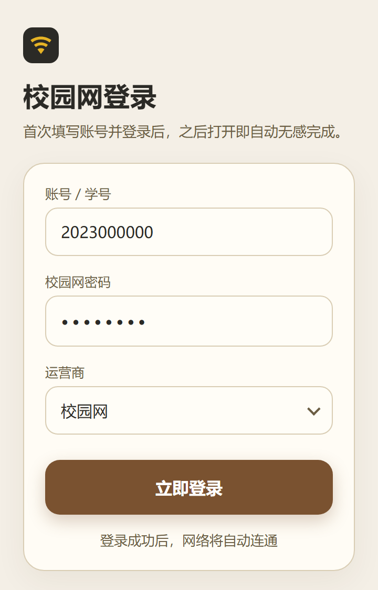

<div align="center">


# 校园网无感登录 · 中国矿业大学（CUMT）

连上校园 Wi‑Fi，自动完成登录，全程不打扰——只在后台发一次请求，完成后弹一则安静的通知告诉你结果。

[](#适用学校重要)
[](https://github.com/muge-heng/cumt-silent-login/releases)
[](https://github.com/muge-heng/cumt-silent-login/releases)
[](#下载安装)
[](#从源码构建)
[](#从源码构建)
[](LICENSE)

</div>

> **适用学校（重要）**：本项目按**中国矿业大学（CUMT）**的校园网门户写死了认证地址与参数
> （`http://10.2.5.251:801/eportal/`，Dr.COM 风格 ePortal）。**其他学校请勿直接安装使用**——你们的门户地址、认证参数和返回格式几乎一定不同，
> 直接装上只会登录失败。若你所在学校也是同类 ePortal，可自行改代码适配，见 [适配其他学校（泛化）](#适配其他学校泛化)。

---

## 界面预览

<div align="center">
  
</div>

> 上图是**首次打开**时的设置页。填过一次并成功登录后，这个页面就再也不会出现——之后每次打开都是无感的。

## 特性

- **无感登录**：配置好之后打开应用，不显示任何前台页面，后台直接完成登录，随即退出。
- **只弹一则通知**：登录结果用一条安静、明确的中文通知告知（成功 / 已在线 / 失败原因），不响铃、不打断。
- **一次配置，长期有效**：账号、密码、运营商填一次即记住；想改只需清除应用数据。
- **支持四大接入**：校园网 / 中国移动 / 中国联通 / 中国电信，登录地址一致，仅账号后缀不同。
- **零第三方依赖**：纯 Android 框架实现，包体极小（约 25 KB），无广告、无统计、无联网后台。
- **本地存储**：账号密码只保存在本机应用数据里，除 CUMT 校园网门户外不向任何服务器发送信息。

## 下载安装

1. 到 [Releases](https://github.com/muge-heng/cumt-silent-login/releases) 下载 `cumt-silent-login-v1.0.0.apk`。
2. 在手机上打开安装包，允许“来自此来源的应用”安装。
3. 安装完成即可，见下方使用方法。

> 需要 Android 8.0（API 26）及以上，且为中国矿业大学（CUMT）校园网用户。

## 使用方法

**第一次打开**
1. 填写「账号 / 学号」和「校园网密码」。
2. 选择「运营商」：校园网 / 中国移动 / 中国联通 / 中国电信。
3. 点「立即登录」。首次会申请一次通知权限，建议允许，以便无感登录时能看到结果。
4. 登录成功后，账号即被记住。

**之后的每一次**
- 直接点开应用图标即可：应用不显示任何页面，在后台自动完成登录，完成后弹一则通知告诉你结果。
- 配合下面的「妙用」，可以做到连上 Wi‑Fi 就自动登录，连“点开”都省了。

## 填错了怎么改

应用没有提供修改入口（保持极简）。如果账号、密码或运营商填错了：

- **Android**：设置 → 应用 → 校园网无感登录 → 存储 → **清除数据**（或“清除全部数据”）。
- 重新打开应用，即回到首次设置页，重新填写即可。

> 只是网络没连上导致的登录失败，不需要清除数据——连上校园 Wi‑Fi 后重新打开应用重试即可。

## 妙用：连上 Wi‑Fi 自动登录

支持“快捷指令 / 自动化”的手机系统，可以设置成**一连上校园 Wi‑Fi 就自动打开本应用**，实现真正零操作的无感登录。基本思路都是新建一条“自动指令”：触发条件选“连接到指定 Wi‑Fi”，执行动作选“打开应用 → 校园网无感登录”。

- **OPPO（小布指令）**：小布助手 → 指令 / 快捷指令 → 新建“自动指令” → 触发条件选「连接到指定 Wi‑Fi」（填校园网 SSID，如 `CUMT_Stu`）→ 执行动作选「控制应用 → 打开 → 校园网无感登录」。
- **vivo（蓝心小 v）**：蓝心小 v → 快捷指令 → 创建自动化 → 条件设为「连接到指定 Wi‑Fi」→ 操作设为「打开应用 → 校园网无感登录」。
- 其它带“Bixby 例程 / 小艺建议 / Tasker”等自动化能力的机型同理，条件用“连接 Wi‑Fi”，动作用“打开应用”。

## 原理介绍

中国矿业大学的校园网认证是一个 **Dr.COM 风格的 ePortal 门户**：设备连上校园 Wi‑Fi 后并未真正放行，所有对外访问会被重定向到内网门户 `10.2.5.251:801`，需要提交一次带账号密码的认证请求，门户校验通过后才放行联网。本应用就是把这一步自动化了。

**1. 发起认证（JSONP GET）**
应用向门户发送一个带查询参数的 GET 请求（不是表单 POST），关键字段：

```
http://10.2.5.251:801/eportal/?c=ACSetting&a=Login
  &DDDDD=<账号><运营商后缀>   // 如 2023xxxx@cmcc
  &upass=<密码>
  &callback=dr<时间戳><随机数> // JSONP 回调名
  &login_method=1&wlan_user_ip=<本机IP>&wlan_user_mac=<MAC>
  &jsVersion=3.0&_=<时间戳>
```

- 认证只依赖 `DDDDD`（账号+后缀）与 `upass`（密码）；`wlan_user_ip / mac` 只是接入侧信息位，不参与校验。
- **运营商 = 账号后缀**：校园网无后缀、中国移动 `@cmcc`、中国联通 `@unicom`、中国电信 `@telecom`，登录地址不变。

**2. 判定结果（解析非中文的 JSONP 返回）**
门户返回形如 `drxxxx({"result":"1","msg":"认证成功"})` 的 JSONP，其中 `result` 是**字符串状态码**。应用剥掉回调、按 `result` / `ret_code` 判定：

| 门户返回 | 判定 | 通知文案 |
| --- | --- | --- |
| `{"result":"1","msg":"认证成功"}` | 登录成功 | 校园网已登录 |
| `{"result":"0","msg":"","ret_code":"2"}` | 终端 IP 已在线（已登录） | 校园网已在线 |
| `{"result":"0", …ret_code≠2…}` | 认证未通过（账号 / 密码等） | 登录失败 |
| 门户不可达（连不上 `10.2.5.251`） | 未连到校园网 | 未连到校园网 |

当返回含义不明确时，应用再向公网发一次连通性探测作为**兜底判据**，避免误报。

**3. 无感执行**
- 已配置时，`MainActivity` 用一个透明主题立即启动后台 `IntentService` 并 `finish()`，**不显示任何前台页面**；
- 服务在后台线程完成“发请求 → 判定 → 弹一则通知”，处理完即自行结束，进程随后回收。

## 适配其他学校（泛化）

本仓库按 CUMT 环境写死，但结构是通用的。若你所在学校也是同类 Dr.COM / ePortal 门户，改动集中在
[`app/src/main/java/com/muge/cumtsilent/PortalClient.java`](app/src/main/java/com/muge/cumtsilent/PortalClient.java)：

1. **门户地址**：改 `EPORTAL_LOGIN_URL_BASE`（例如 `http://<你们学校门户IP>:<端口>/eportal/`）。
2. **请求参数**：如参数名不同（`c`/`a`/`DDDDD`/`upass`/`callback` 等），改 `login()` 里拼接的 query。
3. **运营商后缀**：改 `ISP_SUFFIX` 映射（不同学校可能没有运营商之分，可只留一项空后缀）。
4. **返回判定**：改 `interpret()` 里对 `result` / `auth_fail_info` 的解析，匹配你们门户的实际返回字段。
5. **明文 HTTP**：门户多为内网 `http://`，`AndroidManifest.xml` 已开 `usesCleartextTraffic`；若你们门户是 HTTPS 可按需收紧。
6. 若门户类型不同（如锐捷、H3C iMC、深信服等），认证流程差异较大，需按该校协议重写 `PortalClient`，其余（无感执行、通知、设置页）可复用。

> 建议泛化时同步改 `applicationId`、应用名与图标，避免与 CUMT 版本混淆。

## 从源码构建

环境：JDK 17、Android SDK（compileSdk 34 / build-tools 34.0.0）、Gradle 8.7（AGP 8.4.0）。

```bash
# 指定你的 Android SDK 路径
echo "sdk.dir=/你的路径/android-sdk" > local.properties

# 构建 debug APK
./gradlew assembleDebug
# 产物：app/build/outputs/apk/debug/app-debug.apk
```

也可以直接用 Android Studio 打开本目录，点 Run 安装到手机。

## 免责声明

- 本项目**仅供中国矿业大学（CUMT）本人有权接入的校园网络使用**，用于自动化本人账号的正常登录。
- 本人与中国矿业大学无任何隶属或代言关系；“CUMT / 中国矿业大学”仅用于说明适用对象。校园网门户地址、账号策略归学校所有。
- 使用他人账号、绕过计费/限流/上网时长等管控，或违反校纪校规的行为，**不在本项目支持范围内，后果由使用者自行承担**。
- 校园网门户可能随学校调整而变更地址、参数或返回格式，导致本应用登录判定失效；届时请自行更新或停止使用。
- 软件按“现状”提供，不含任何明示或暗示的担保；对因使用本软件造成的任何直接或间接损失，作者不承担责任。
- 账号密码仅存储于本机应用数据，不会上传；但请自行妥善保管设备，避免他人获取。

## 许可

[MIT](LICENSE) © 2026 muge-heng
